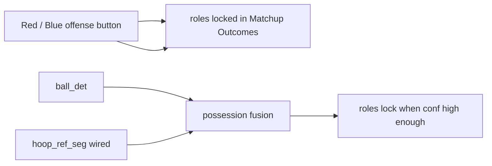

# ScoutIQ VisionPlay — Updates (2026-07-21)

Branch: `7/21/2026`  
Date: July 21, 2026

This README summarizes what shipped on today’s branch: **usable offense/defense now** (manual Red/Blue lock + wired hoop model for Auto), plus the **hoop + referee YOLO-seg training factory** that produced `best_hoop_ref_seg.pt`.

---

## Highlights

1. **Manual O/D that you can trust** — Matchup Outcomes buttons are **Team Red on offense** / **Team Blue on offense** / **Auto**, with a clear lock line (`Offense: Red · Defense: Blue`).
2. **Hoop model plugged into live Analyze** — `best_hoop_ref_seg.pt` enabled for attacking-direction; referees filtered out; last-seen rim carried across sparse detect gaps.
3. **Hoop + ref segmentation training path** — GDINO → SAM2 → YOLO-seg factory, batch-12 train config, orchestrator script.
4. **No extra training required for the button path** — click Red/Blue after Confirm to force correct Matchup roles immediately.

---

## Straight answer: does O/D work?

| Path | Status |
|------|--------|
| **Manual** | Works now. After Confirm, open Matchup Outcomes → click **Team Red on offense** or **Team Blue on offense**. Roles lock; Stay Close = defense, Create Space = offense. |
| **Auto** | Improved on this branch. Ball was already on; hoop (attacking-direction) is now enabled and uses the trained seg weights. Still not perfect on every broadcast angle — use the button when Auto is wrong. |



---

## 1. Manual offense override (product path)

**UI:** [`FrontEnd/src/components/CoachInsights.jsx`](FrontEnd/src/components/CoachInsights.jsx), styles in [`FrontEnd/src/index.css`](FrontEnd/src/index.css)

- Relabeled **Team 0 / Team 1** → **Team Red on offense** / **Team Blue on offense** / **Auto**
- Maps to jersey `team_id` **0 = Red**, **1 = Blue** (same as `jersey_team_colors.py`)
- Shows lock state: `Offense: Red · Defense: Blue` and whether lock came from your click or Auto

**API (unchanged contract):** `POST /api/jobs/{job_id}/offense-team`  
Body: `{ "mode": "manual"|"auto", "offense_team_id": 0|1|null }`  
Implemented in [`app/api_server.py`](app/api_server.py) → [`src/ball/live.py`](src/ball/live.py) `apply_offense_team_override`. Success messages now say Team Red / Team Blue.

---

## 2. Wire hoop for Auto attacking-direction

**Config:** [`configs/player_tracking_mvp.yaml`](configs/player_tracking_mvp.yaml)

```yaml
ball:
  hoop:
    enabled: true
    weights: outputs/training_loop_hoop_ref/best_hoop_ref_seg.pt
    conf: 0.40
    every_n_frames: 15
```

**Code:**

| File | Change |
|------|--------|
| [`src/ball/hoop.py`](src/ball/hoop.py) | `detect_hoops()` keeps **class 0 (hoop)** only — skips referee class 1 |
| [`src/ball/live.py`](src/ball/live.py) | Carry last-known hoop across missed frames / `every_n_frames` gaps (clear on scene cut) |
| [`src/pipeline/player_track_pipeline.py`](src/pipeline/player_track_pipeline.py) | Defaults match YAML |

**How to verify on a new Analyze**

1. Restart API/dashboard if already running (so YAML reloads).
2. Run **Analyze** on a clip.
3. Confirm `outputs/jobs/<job_id>/hoop_tracks.jsonl.gz` exists and has boxes.
4. After Confirm (≥2 opposite-team players), Matchup shows Auto lock when fusion is confident — or click Red/Blue to force.

Weights path (local, not committed if large):  
`scoutiq/outputs/training_loop_hoop_ref/best_hoop_ref_seg.pt`

---

## 3. Hoop + referee segmentation training factory

New dedicated 2-class YOLO-seg path (`0: hoop`, `1: referee`), separate from player seg and ball detect.

| Piece | Path |
|-------|------|
| Autolabel + dataset builder | [`src/ball/hoop_ref_seg.py`](src/ball/hoop_ref_seg.py) |
| CLI | `python -m src.ball hoop-ref-autolabel` / `hoop-ref-build-dataset` / `hoop-ref-train` |
| Train config (batch **12**) | [`configs/showcase_hoop_ref_seg_train.yaml`](configs/showcase_hoop_ref_seg_train.yaml) |
| Orchestrator | [`scripts/run_hoop_ref_seg_training.py`](scripts/run_hoop_ref_seg_training.py) |
| Seg export name support | [`src/showcase/train_loop.py`](src/showcase/train_loop.py) `output.weights_name` |

**From `scoutiq/`:**

```powershell
..\.venv\Scripts\python.exe -u scripts\run_hoop_ref_seg_training.py
```

**2026-07-20 training result (reference)**

| Metric | Value |
|--------|-------|
| Dataset | ~1675 train / 539 val |
| Box mAP50 | ~0.705 |
| Mask mAP50 | ~0.678 |
| Gates | passed (box ≥0.55, mask ≥0.45) |

At live conf 0.80–0.90 precision is high but recall drops — live hoop conf is **0.40** for usable attacking-direction coverage; use the Red/Blue button when Auto roles are wrong.

---

## What this branch does *not* claim

- Auto O/D is perfect on every camera angle / cutaway.
- Manual per-player red↔blue team reassignment (jersey clustering still assigns sides; override is which side is on offense).
- Another hoop training run is required before the button works — it is not.

---

## Success criteria

- [x] Matchup Outcomes: **Team Red on offense** / **Team Blue on offense** locks roles immediately after Confirm.
- [x] Live config points at `best_hoop_ref_seg.pt` with hoop enabled + class filter + rim carry.
- [x] Documented hoop+ref training factory and how to re-run it.
