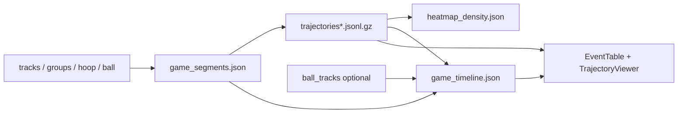

# ScoutIQ VisionPlay — Updates (2026-07-22)

Branch: `7/21/2026`  
Date: July 22, 2026

This README summarizes today’s work: replace the heatmap-first UX with a **2D screen-space trajectory + events system** built from existing tracking outputs (**no YOLO / ByteTrack re-run**). Phases **1–13** are in; court calibration (Phase 14) is still deferred.

---

## Highlights

1. **Player Movement viewer** — screen-space paths, arrows, fade, and optional density from the same analytics-safe points.
2. **Gameplay segments** — wide / closeup / transition classification; only `wide_gameplay` is usable for analytics.
3. **Game timeline** — camera, tracking, movement, defensive proximity, and probable ball events → `analytics/game_timeline.json`.
4. **Game Events UI** — live table with filters; click seeks video and focuses trajectories.
5. **Config-driven thresholds** — all under `analytics.*` in [`configs/player_tracking_mvp.yaml`](configs/player_tracking_mvp.yaml).

```text
tracks.jsonl.gz + person_groups / hoop / quality / ball
  → segments → trajectories (+ fragments)
  → density + game_timeline events
  → React viewer (paths + density) + EventTable
```

Contact point: bbox bottom-center. Coords = **normalized screen-space** (not court feet).

---

## Hardware / runtime note (this machine)

Today’s config is tuned for **CPU-only** local hardware — not a CUDA GPU box.

In [`configs/player_tracking_mvp.yaml`](configs/player_tracking_mvp.yaml):

| Setting | Current value | Meaning |
|---------|---------------|---------|
| Top-level `device` | `"cpu"` | Player tracking / seg inference on CPU |
| `ball.device` | `"cpu"` | Ball (+ hoop) detect path on CPU |

Analytics Phases 2–13 (trajectories, segments, density, timeline, events) are **CPU-friendly by design**: they only read existing job artifacts and do not re-run YOLO. Analyze / Confirm will still be slower on CPU than on GPU.

To use a GPU later, set `device: "0"` (and `ball.device: "0"`) when CUDA is available — leave analytics thresholds as-is.

---

## Pipeline at a glance



---

## What shipped (Phases 1–13)

| Phase | Deliverable | Key location |
|-------|-------------|--------------|
| 1 | Inspect writers / schemas / API / stubs | (docs only) |
| 2 | Trajectory data layer | [`src/analytics/trajectories.py`](src/analytics/trajectories.py) |
| 3–4 | Gameplay segments + closeups | [`src/analytics/segments.py`](src/analytics/segments.py) |
| 5 | Analytics-safe filter + path fragments | trajectories dual outputs |
| 6 | Generate / GET API | [`src/analytics/service.py`](src/analytics/service.py), [`app/api_server.py`](app/api_server.py) |
| 7 | React trajectory viewer | [`FrontEnd/src/components/TrajectoryViewer.jsx`](FrontEnd/src/components/TrajectoryViewer.jsx) |
| 8 | Heatmap density layer | [`src/analytics/heatmap_density.py`](src/analytics/heatmap_density.py) |
| 9 | Camera / tracking timeline | [`src/analytics/timeline.py`](src/analytics/timeline.py) |
| 10 | Movement events | [`src/analytics/events_movement.py`](src/analytics/events_movement.py) |
| 11 | Defensive proximity events | [`src/analytics/events_defense.py`](src/analytics/events_defense.py) |
| 12 | Probable ball events | [`src/analytics/events_ball.py`](src/analytics/events_ball.py) |
| 13 | Game Events frontend | [`FrontEnd/src/components/EventTable.jsx`](FrontEnd/src/components/EventTable.jsx) |

### Job artifacts

Written under `outputs/jobs/<job_id>/analytics/`:

| File | Role |
|------|------|
| `trajectories.jsonl.gz` | Raw path points |
| `trajectories_analytics.jsonl.gz` | Usable / filtered fragments |
| `trajectory_summary.json` | Counts + video meta |
| `game_segments.json` | Camera segments + flips + cuts |
| `heatmap_density.json` | Binned screen-space density |
| `game_timeline.json` | Merged events + summary |

### API

| Method | Path |
|--------|------|
| POST | `/api/jobs/{job_id}/analytics/trajectories/generate` |
| GET | `/api/jobs/{job_id}/analytics/trajectories?variant=analytics\|raw` |
| GET | `/api/jobs/{job_id}/analytics/segments` |
| GET | `/api/jobs/{job_id}/analytics/timeline` |

Generate builds segments → trajectories → density → timeline in one call (ball missing soft-skips ball events only).

---

## Event categories (timeline)

| Category | Examples | Language |
|----------|----------|----------|
| **Camera** | gameplay started/ended, closeup, orientation change, resume | High confidence from segments |
| **Tracking** | quality dropped / recovered | From hard cuts |
| **Movement** | stationary / moving, accel, turn, converge / separate | Screen-space speed/distance |
| **Defense** | pressure start/end, separation, help, double team, matchup change | *possible / likely* only |
| **Ball** | possession change, near player, toward hoop, possible shot | *probable / possible*; **no make/miss claim** |

All distance/speed fields say **normalized screen-space**, not feet/meters or official stats.

---

## Frontend

| Surface | Behavior |
|---------|----------|
| **Player Movement** | Generate / regenerate; player / team / segment / time filters; paths + density + event focus marker |
| **Game Events** | Loads timeline; filters by category / confidence / player / segment; details JSON |
| **Click event** | Seeks tracking + processed video; focuses TrajectoryViewer (players, segment, time window) |

Helpers: `generateJobTrajectories`, `getJobTrajectories`, `getJobSegments`, `getJobTimeline` in [`FrontEnd/src/API/scoutiqAPI.js`](FrontEnd/src/API/scoutiqAPI.js).

---

## Config (`analytics.*`)

In [`configs/player_tracking_mvp.yaml`](configs/player_tracking_mvp.yaml):

- `trajectories.max_gap_frames`
- `heatmap_density.bins_x` / `bins_y`
- `movement_events.*` — speeds, turns, pair distances, cooldowns
- `defense_events.*` — pressure / double-team / matchup thresholds
- `ball_events.*` — near-player, toward-hoop, shot heuristics (soft-skip if no ball tracks)
- `segments.*` — hoop side, cuts, closeup rules

---

## Tests

Focused unit / API coverage:

- `tests/test_trajectories.py`
- `tests/test_segments.py`
- `tests/test_heatmap_density.py`
- `tests/test_timeline.py`
- `tests/test_events_movement.py`
- `tests/test_events_defense.py`
- `tests/test_events_ball.py`
- `tests/test_analytics_api.py`

From `scoutiq/`:

```powershell
.\.venv\Scripts\python.exe -m pytest tests/test_trajectories.py tests/test_segments.py tests/test_heatmap_density.py tests/test_timeline.py tests/test_events_movement.py tests/test_events_defense.py tests/test_events_ball.py tests/test_analytics_api.py -q
```

---

## How to verify on a real clip

1. Restart API / dashboard so YAML and frontend reload.
2. **Analyze** a clip until job status is ready.
3. Open **Player Movement** → **Generate trajectories**.
4. Confirm paths + density draw; regenerate if you change filters/config.
5. Open **Game Events** — rows should match `game_timeline.json` summary counts.
6. Click an event — video seeks; trajectory panel highlights related players / segment.

Optional CLI:

```powershell
.\.venv\Scripts\python.exe -c "from src.analytics.timeline import generate_timeline_for_job; print(generate_timeline_for_job(r'outputs/jobs/<id>')['summary'])"
```

---

## What this work does *not* claim

- True court coordinates, paint entry, or speeds in feet (Phase **14** deferred).
- Official basketball stats (shots made/missed, true defensive metrics).
- Re-running detection for analytics — generation reuses job artifacts only.
- Perfect Auto O/D or ball recall on every broadcast angle (same caveats as 7/21).

---

## Success criteria

- [x] Trajectories + segments generate from existing tracks without YOLO re-run.
- [x] Closeups / transitions excluded from analytics-safe paths and density.
- [x] Density is optional and uses the same filtered points as paths.
- [x] Timeline merges camera, tracking, movement, defense, and ball events with confidence + screen-space wording.
- [x] Missing ball tracks does not block timeline generation.
- [x] Game Events UI is live (filters, details, seek + trajectory focus).
- [ ] Phase 14 court calibration — only if explicitly approved later.
